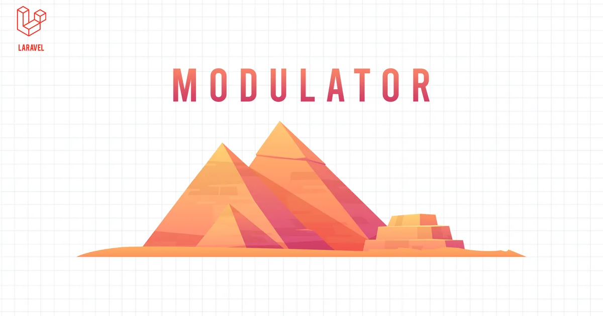

<p align="center"><a href="https://pharaonic.dev/packages/laravel/modulator" target="_blank"></a></p>

<p align="center">
  <a href="https://php.net" target="_blank"></a>
  <a href="https://laravel.com" target="_blank"></a>
  
  
  <br>
  <a href="https://packagist.org/packages/Pharaonic/laravel-modulator" target="_blank"></a>
  <a href="https://packagist.org/packages/pharaonic/laravel-modulator" target="_blank"></a>
  <a href="https://packagist.org/packages/pharaonic/laravel-modulator" target="_blank"></a>
  <a href="https://pharaonic.dev/packages/laravel/modulator#ai-ready" target="_blank"></a>
</p>

<h3 align="center">Laravel-native modules: discovered by convention, nested, overridable from packages, and autoloaded in every Composer mode.</h3>
<br>

## Installation

```bash
composer require pharaonic/laravel-modulator
```

The service provider is registered automatically. Publish the configuration when you need to change it:

```bash
php artisan vendor:publish --tag=modulator-config
```

## Usage

A directory with `app/` under `Modules/` is a module. No `composer.json` or manifest is needed:

```bash
php artisan module:make Shop
php artisan module:make:model Shop Product --migration
```

```php
// Modules/Shop/app/Models/Product.php
namespace Modules\Shop\Models;

use Illuminate\Database\Eloquent\Model;

final class Product extends Model {}

// Anywhere in the application
Modules\Shop\Models\Product::query()->get();
Pharaonic\Laravel\Modulator\Facades\Modules::find('Shop')->isEnabled();
```

On deployment, after `composer install`, run `php artisan module:cache`.

## Documentation

Full documentation: [Laravel Modulator Documentation](https://pharaonic.dev/packages/laravel/modulator).

## Support & Security

See [SUPPORT.md](SUPPORT.md) and [SECURITY.md](SECURITY.md). Contributions are welcome; see [CONTRIBUTING.md](CONTRIBUTING.md).

## License

MIT. See [LICENSE](LICENSE).
